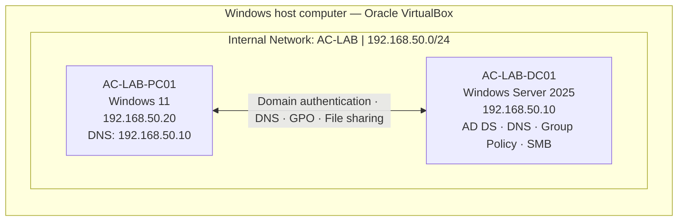
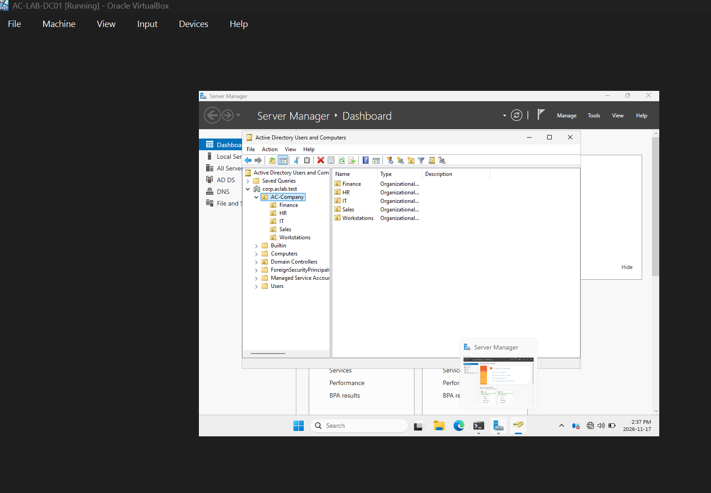
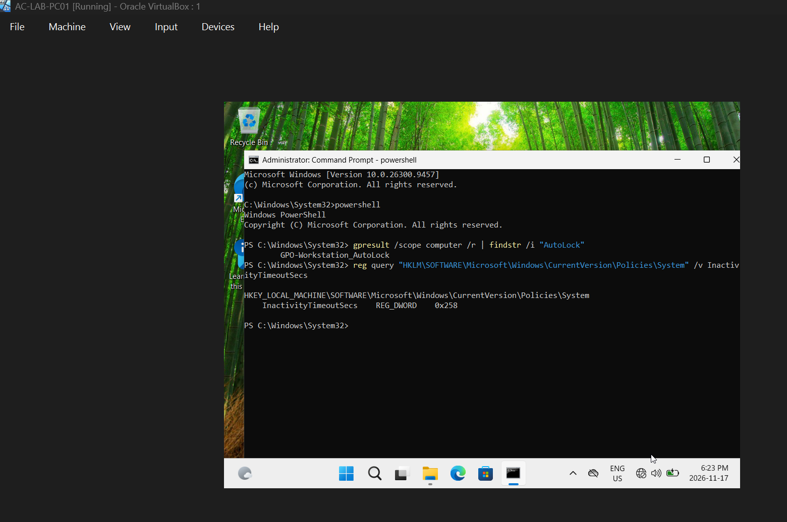
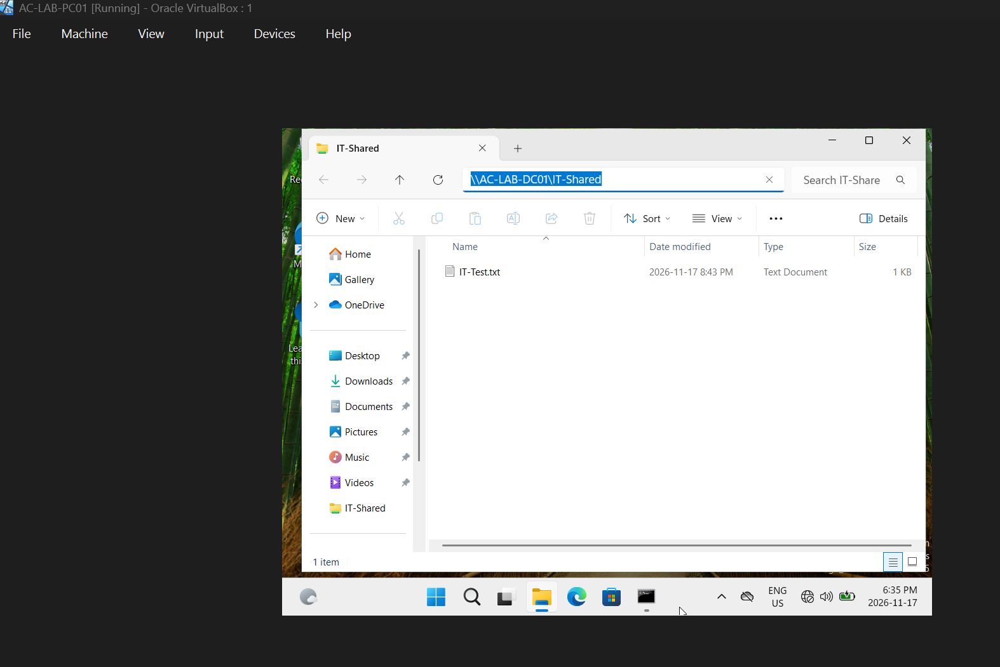
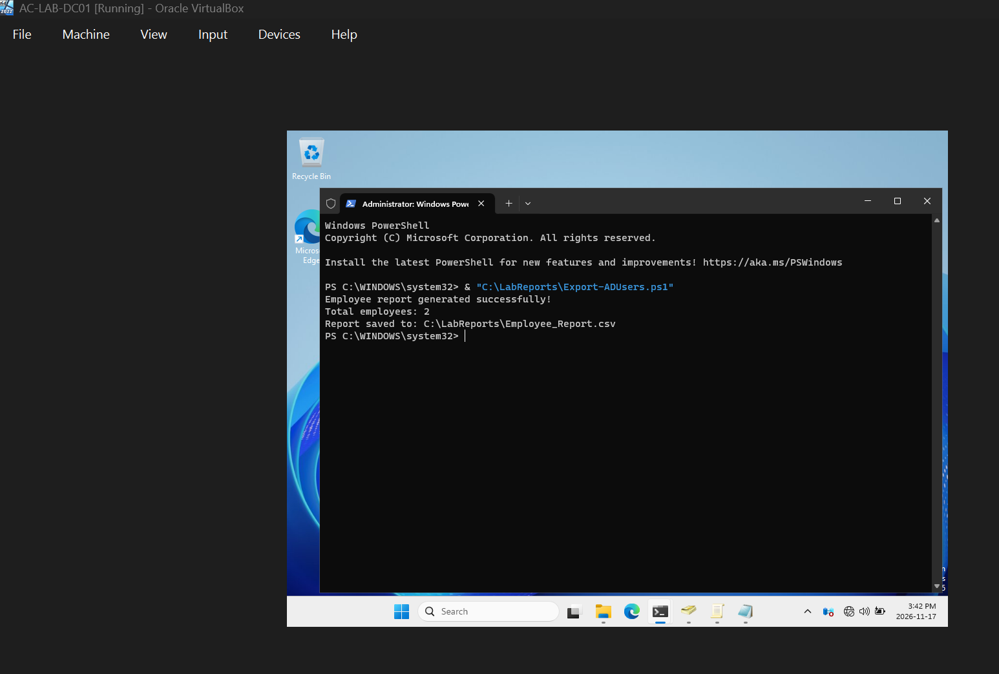

# Windows Server 2025 & Active Directory Help Desk Lab

**A hands-on Windows IT support portfolio project using Windows Server 2025, Windows 11, Active Directory, DNS, Group Policy, SMB file sharing, and PowerShell.**

This project simulates common tasks performed by an IT Help Desk Technician in a small company: onboarding employees, managing domain accounts, joining a PC to a domain, applying workstation security policies, granting access to shared resources, and producing reports with PowerShell.

> **Environment:** Isolated, local VirtualBox lab using fictional users and test data. This is a learning project, not a production deployment.

## Technologies used

- Oracle VirtualBox — local virtualization
- Windows Server 2025 Standard Evaluation — domain controller
- Windows 11 — domain-joined client workstation
- Active Directory Domain Services (AD DS) and DNS
- Group Policy Management (GPMC)
- Security groups, organizational units (OUs), and NTFS/SMB permissions
- Windows PowerShell and the ActiveDirectory module

## Network architecture



| Component | Configuration |
| --- | --- |
| Active Directory domain | `corp.aclab.test` |
| NetBIOS domain | `CORP` |
| Domain controller | `AC-LAB-DC01` (`192.168.50.10`) |
| Windows 11 workstation | `AC-LAB-PC01` (`192.168.50.20`) |
| Network mode | VirtualBox Internal Network (`AC-LAB`) |
| Client DNS server | `192.168.50.10` |
| Default gateway | Not configured on the isolated lab network |

Both virtual machines use the same isolated internal network. The Windows 11 client uses the domain controller for DNS and domain services. The internal network is intentionally not internet-facing.

## Active Directory organization

```text
corp.aclab.test
└── AC-Company
    ├── Finance
    ├── HR
    ├── IT
    │   ├── Amsu Magar (amsu.magar)
    │   └── GG_IT_Staff (security group)
    ├── Sales
    └── Workstations
        └── AC-LAB-PC01 (computer account)
```

Created fictional employee accounts to practice account provisioning, password resets, group membership, and disabling accounts. The employee report includes one enabled sample account and one disabled sample account.

## Tasks performed and verified

### 1. Domain services and workstation join

- Installed Windows Server 2025 and configured a static IP address.
- Installed AD DS and DNS and promoted the server to a new forest: `corp.aclab.test`.
- Created company OUs, user accounts, and security groups.
- Configured Windows 11 DNS to point to `192.168.50.10`.
- Verified domain discovery with DNS lookups, joined `AC-LAB-PC01` to the domain, and signed in with a domain employee account.

**Verification commands on Windows 11:**

```powershell
Get-CimInstance Win32_ComputerSystem | Select-Object Name,Domain,PartOfDomain
whoami
```

### 2. Help Desk account administration

- Practiced resetting an employee password and requiring a change at the next sign-in.
- Inspected account lockout status using the Active Directory PowerShell module.
- Practiced employee account lifecycle operations, including disabling a fictional account.

```powershell
Get-ADUser -Identity amsu.magar -Properties LockedOut |
    Select-Object Name,LockedOut
```

### 3. Workstation security with Group Policy

Created and linked `GPO-Workstation_AutoLock` to the `Workstations` OU.

**Policy path:** Computer Configuration → Policies → Windows Settings → Security Settings → Local Policies → Security Options → **Interactive logon: Machine inactivity limit**

**Configured value:** `600` seconds (10 minutes).

```cmd
gpupdate /force
gpresult /scope computer /r
reg query "HKLM\SOFTWARE\Microsoft\Windows\CurrentVersion\Policies\System" /v InactivityTimeoutSecs
```

Verified that the policy appeared in the applied computer GPOs, the registry value was `0x258` (600 seconds), and the Windows 11 workstation automatically locked after 10 minutes of inactivity.

### 4. SMB network share and NTFS permissions

Published the IT department folder as a network share:

| Setting | Value |
| --- | --- |
| Server folder | `C:\LabShares\IT` |
| Share name | `IT-Shared` |
| Client UNC path | `\\AC-LAB-DC01\IT-Shared` |
| Authorized security group | `GG_IT_Staff` |
| NTFS permission | Modify (including read/write) |

Verified the share existed on Windows Server:

```powershell
Get-SmbShare -Name "IT-Shared"
```

Accessed the share from Windows 11 using the domain employee account and confirmed `IT-Test.txt` was visible.

> This lab combines file-sharing functionality with the domain controller to conserve resources. Production environments should evaluate separating file-server and domain-controller roles.

### 5. PowerShell employee reporting

Created `scripts/Export-ADUsers.ps1`, a reusable script that:

1. Imports the Active Directory module.
2. Queries user accounts beneath `OU=AC-Company,DC=corp,DC=aclab,DC=test`.
3. Selects employee name, username, and enabled/disabled status.
4. Exports results to `C:\LabReports\Employee_Report.csv`.

**Run on a machine with the ActiveDirectory module and appropriate domain permissions:**

```powershell
& "C:\LabReports\Export-ADUsers.ps1"
```

**Observed test result:** Script completed successfully and exported **2 fictional employees**.

## Project screenshots

All images were captured in the actual virtual lab.

| # | Evidence | Screenshot |
| --- | --- | --- |
| 01 | Domain and organizational units | [View](screenshots/01-Active-Directory-OUs.png) |
| 02 | IT user and security group | [View](screenshots/02-IT-Users-Groups.png) |
| 03 | Employee onboarding/offboarding | [View](screenshots/03-HR-Onboarding.png) |
| 04 | Windows 11 domain membership | [View](screenshots/04-Windows11-Domain-Join.png) |
| 05 | Employee domain login | [View](screenshots/05-Employee-Login.png) |
| 06 | 600-second AutoLock policy | [View](screenshots/06-Group-Policy-AutoLock.png) |
| 07 | Applied GPO and registry verification | [View](screenshots/07-GPO-Verification.png) |
| 08 | NTFS permissions for IT group | [View](screenshots/08-IT-Folder-Permissions.png) |
| 09 | Network share from Windows 11 | [View](screenshots/09-Network-Share-Test.png) |
| 10 | Employee-report script | [View](screenshots/10-PowerShell-Script.png) |
| 11 | Script execution success | [View](screenshots/11-PowerShell-Success.png) |
| 12 | Exported employee CSV | [View](screenshots/12-Employee-CSV.png) |

### Highlights

**Domain structure**



**Group Policy — automatic lock**



**Windows 11 network share access**



**PowerShell reporting**



## Troubleshooting experience

This lab also included diagnosing practical issues:

- **Domain join errors:** Checked `C:\Windows\Debug\NetSetup.log`, DNS SRV records, and domain administrator authentication before successfully joining the workstation.
- **GPO not initially appearing in `gpresult`:** Checked OU placement, GPO linking/security filtering, computer policy revisions, and refreshed policy before validating the 10-minute lock.
- **Network share discovery:** Distinguished between commands run on the client and server; confirmed the SMB share using `Get-SmbShare` on the server and opened the UNC path in File Explorer on Windows 11.
- **PowerShell syntax:** Corrected command/parameter spelling and spacing, then generated a working reusable reporting script.

## Repository structure

```text
Active-Directory-HelpDesk-Lab/
├── README.md
├── screenshots/
│   ├── 01-Active-Directory-OUs.png
│   ├── 02-IT-Users-Groups.png
│   ├── ...
│   └── 12-Employee-CSV.png
├── scripts/
│   └── Export-ADUsers.ps1
└── documentation/
```

## Skills demonstrated

Windows Server administration · Active Directory user support · DNS troubleshooting · domain joining · organizational units · security groups · Group Policy · SMB and NTFS permissions · PowerShell automation · documentation and troubleshooting.

## Safety and scope

All users and content in this lab are fictional. The domain and internal IP addresses are local test infrastructure. No real employee credentials, passwords, recovery keys, or production data are published. Screenshots should be reviewed before uploading, and VM disks (`.vdi`, `.vbox`) and ISO installers should not be committed to the repository.

---

**Project outcome:** Built and tested a small virtual Windows domain environment supporting common entry-level IT Help Desk scenarios, with screenshots, troubleshooting notes, and reusable PowerShell automation.
